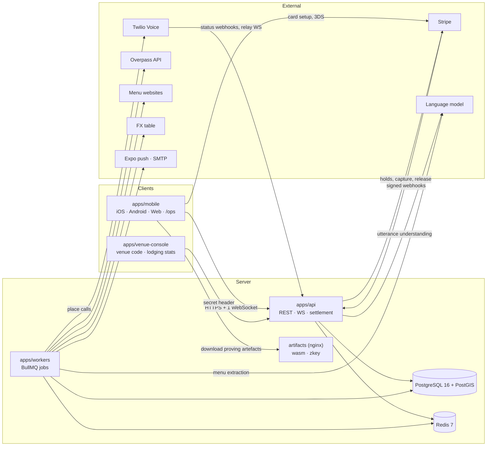

# Architecture

How Tablemate is built as this branch stands: the process and workspace split, the security and
failure-isolation rules, the idempotency machinery behind the money and the background work, the code
invariants, and the versions every manifest pins. It describes the code in this repository rather than
the plan behind it (AAP 0.3.2, 0.5.1, 0.6.1, 0.8.1), and where the code departs from a value the plan
states, a **Deviation** line names that value. For the proof see [zk-proofs.md](./zk-proofs.md) and
[zk-performance.md](./zk-performance.md), for the data inventory and retention
[privacy.md](./privacy.md), for the routes [api/README.md](./api/README.md), for the client targets and
every deviation from the request's platform list [platform-notes.md](./platform-notes.md), and for the
runbook [operations.md](./operations.md).

## Overview

**Product.** Tablemate (a working name, to be replaced before launch) is a mobile-first social network
for travelers in which two travelers staying in the same city arrange an in-person meetup at a partner
venue.

**Trust.** Three mechanisms carry it, and identity disclosure is none of them: a zero-knowledge proof of
a real lodging booking, generated on the traveler's own device from a `.eml` confirmation and never
leaving the server any of its content; a check-in witnessed by the venue's rotating six-digit code and
the attendee's coordinates; and a small refundable card-authorization hold of 5, 10 or 20 USD placed by
each side, captured from an absent party and credited to the attendee who showed up.

**Hypothesis.** Travelers will stake a small refundable amount when the deposit is framed socially —
"Hold a seat at the table. Your 10 USD comes back as soon as you both show up." — rather than
punitively ("You'll lose 10 USD if you don't show up."). Each account is assigned to one of the two
variants once, by a salted hash of its id, and the assignment is never recomputed
(`apps/api/src/modules/experiment/assignment.ts`).

**Headline metric.** The **meetup completion rate**: meetups with both attendees checked in divided by
meetups with both deposits locked. Both terms come from `Meetup.lockedAt` and the `CheckIn` rows, not
from `Meetup.status`, so a later hold loss or dispute resolution moves neither
(`apps/api/src/modules/admin/metrics.ts`). Signups are secondary, below the fold of the dashboard, and
never appear in the headline area.

**Surfaces.** One Expo SDK 52 app serves iOS 16+, Android 10+ (API 29+) and the web, and its web build
also renders the operator dashboard and queues under `/ops`. Beside it: the venue and lodging console
(`apps/venue-console`), the API (`apps/api`), the job service (`apps/workers`), the shared contract and
server packages, and the circuit package (`packages/circuits`).

**Delivery form.** Container images and a local `docker-compose` stack, with no production provisioning:
`docker compose up` starts the pilot's whole stack on one machine with no third-party credential. Native
builds are development and internal ones only, because the Expo SDK 52 configuration this plan pins
(target API 34, Xcode 16.4) sits below the current Google Play and App Store minimums — see
[platform-notes.md](./platform-notes.md).

**Scale.** A pilot across five launch cities — Lisbon, Mexico City, Medellín, Chiang Mai and Canggu —
held to an API p95 of 300 ms for reads and 800 ms for writes at 50 requests per second on the local stack
([performance.md](./performance.md)).

## Pattern

**A modular monolith with a separate worker process.** The API is one Fastify 5 application assembled
from one plugin per domain module under `apps/api/src/modules/<module>/`; `buildApp` in
`apps/api/src/app.ts` is its composition root. Slow and third-party work runs in `apps/workers`, a
process of its own that consumes the same queues. Two web front ends, one pnpm workspace and one
PostgreSQL schema shared by the two server processes complete the shape.

**Why this shape.** The plan's placement directives put every state transition, the settlement schedule
and the only Stripe secret in `apps/api`, and crawling, telephony, menu extraction and their
language-model calls in `apps/workers`; process separation is what keeps a failure in any of those away
from proposing, locking, checking in and settling. At pilot scale a microservice split would add
deployment and consistency cost for no benefit. The API is stateless behind Redis — rate-limit
counters, WebSocket fan-out and the BullMQ queues — so more replicas can run without a code change,
and settlement is serialized by a row lock on the meetup, so a second replica cannot double-settle.

**Data flows.**

- **Itinerary proof.** The device picks the `.eml`, parses it, builds the circuit inputs, proves locally
  and posts only `{ proof, publicSignals }`. The API verifies the proof against the published
  verification key, checks the registry root, the salt and the nullifier, stores the public outputs and
  records the spent nullifier. No private input, proving key or circuit WASM exists on the server.
- **Meetup.** A proposal and an acceptance each place a server-confirmed card hold, and Stripe webhooks
  advance the deposit state. Check-ins are evaluated in the API. Settlement runs in the API process at
  start + 45 minutes. Every transition writes its analytics events and its outbox rows in the same
  transaction as the state change, and the outbox dispatcher delivers them after the commit.
- **Magic link.** `POST /auth/magic-link` writes one `MagicLinkToken` row holding the token hash, the
  email's ciphertext and lookup hash, and the token itself as `deliveryTokenCiphertext`, plus a
  `notification` outbox row carrying only that row's id. The `notifications` job in `apps/workers`
  checks `expiresAt` first — an expired token has its ciphertext nulled and nothing is sent — and
  otherwise decrypts the address and the token, sends the link and nulls the ciphertext in that step.
  Any ciphertext left after expiry is nulled by the next hourly `data-expiry` run, and the row is purged
  24 hours after expiry.
- **Prices.** `apps/workers` refreshes places and lodgings from Overpass, fetches and extracts menus,
  queues and places calls, and writes `PriceRecord` rows with their capture batch. The suggestion route
  in the API only reads them.
- **Lodging claim.** The API creates the claim and encrypts the booking details. `apps/workers` creates
  the call task and dials. The API's voice relay runs the dialogue, because Twilio's ConversationRelay
  socket terminates there, and records the authenticated result on the `CallAttempt` together with an
  `apply_call_result` outbox row. `apps/workers` applies that result to the task and the claim and
  erases the booking details.

### The plan's component names, as delivered (AAP 0.5.1)

- **`dispatchPending()` (Outbox).** Delivered as `createOutboxDispatcher(services)` in
  `apps/api/src/modules/outbox/dispatcher.ts`: `runOnce()` is the pass over the undispatched rows, `kick()`
  the after-commit trigger `outbox/write.ts` calls, `start(2_000)` the two-second loop `app.ts` registers.
- **`scheduleMeetupTimers(meetup)` (Settlement).** Delivered as the per-transition set in
  `apps/api/src/modules/settlement/timers.ts`: `scheduleLockedTimers`, `scheduleLapse`, `removeMeetupTimers`,
  beside `scheduleDisputeEscalation`, one call per transition; all four plan timer ids are scheduled.
- **`hmac(...)` (Server core).** Delivered as `hmac` in `packages/server-core/src/crypto/hashing.ts`, with
  `hmacHex`, `emailLookupHash`, `actorHash` and `pairKey` over it; `secretLookupHash` is an unkeyed `sha256Hex`.
- **`suggest(meetup, budgetCents)`.** Delivered as `suggest` in
  `apps/api/src/modules/suggestions/candidates.ts`, imported by the row's route plugin `suggestions/routes.ts`.
- **`buildRegistry(config)`.** Delivered as `buildRegistry` in `packages/circuits/src/registry/merkle.ts`, with
  `scripts/build-registry.ts` the CLI over it, inside the row's `src/{inputs,registry}/*` slot.

## Workspaces

Eight workspaces, each `"private": true` at version `0.1.0`. The table states what each one owns, which
secrets reach it, and what it runs.

| Workspace              | Responsibility                                                                                                                                                                                                                                                                 | Secrets held                                                                                                                                                                                                                                            | Jobs and disclosure                                                                                                                                                                                                                                                                                                                                                                                                        |
| ---------------------- | ------------------------------------------------------------------------------------------------------------------------------------------------------------------------------------------------------------------------------------------------------------------------------ | ------------------------------------------------------------------------------------------------------------------------------------------------------------------------------------------------------------------------------------------------------- | -------------------------------------------------------------------------------------------------------------------------------------------------------------------------------------------------------------------------------------------------------------------------------------------------------------------------------------------------------------------------------------------------------------------------- |
| `apps/api`             | Every state transition, the REST and WebSocket surface, proof verification, the Stripe holds and webhooks, the console and operator routes, the voice relay and its status webhooks                                                                                            | `DATABASE_URL`, `REDIS_URL`, `JWT_SECRET`, `FIELD_ENCRYPTION_KEY`, `EMAIL_LOOKUP_PEPPER`, `ANALYTICS_SALT`, `EXPERIMENT_SALT`, `NULLIFIER_SALT`, `STRIPE_SECRET_KEY`, `STRIPE_WEBHOOK_SECRET`, `TWILIO_ACCOUNT_SID`, `TWILIO_AUTH_TOKEN`, `LLM_API_KEY` | Runs the `settlement` queue in process (settle, lapse, remind, dispute escalation), the advisory-locked 60-second sweeper, the outbox dispatcher and the `PaymentOperation` executor. The **only** place disclosure is enforced (`apps/api/src/modules/users/disclosure/`)                                                                                                                                                 |
| `apps/workers`         | Place and lodging refresh from Overpass, menu ingestion, FX, call dispatch, application of call results (including lodging-claim resolution), data expiry, account erasure, notification delivery                                                                              | `DATABASE_URL`, `REDIS_URL`, `TWILIO_ACCOUNT_SID`, `TWILIO_AUTH_TOKEN`, `TWILIO_FROM_NUMBER`, `CALL_ALLOWLIST`, `LLM_API_KEY`, `SMTP_URL`, `EXPO_ACCESS_TOKEN`, `FIELD_ENCRYPTION_KEY`, `ANALYTICS_SALT`; **never a Stripe key**                        | Consumes every queue but `settlement` (`WORKER_QUEUES`). Writes no user-facing response. Also reads `API_PUBLIC_URL` (the base of the TwiML and status-callback URLs a dispatched call carries) and `WEB_ORIGIN` (the magic-link base) where the deployment sets them — the compose stack sets both — and neither is required of this process's start: without one, call dispatch or the magic-link delivery fails instead |
| `apps/venue-console`   | `/venue` shows the rotating code with its QR form and countdown; `/lodging` shows the lodging's standing                                                                                                                                                                       | None: the operator-issued secret is typed in and kept in `sessionStorage`                                                                                                                                                                               | None. Polls `GET /v1/venue/check-in-code` at each `expiresAt` and derives the countdown from the offset to the API's `Date` header, which CORS exposes                                                                                                                                                                                                                                                                     |
| `apps/mobile`          | The traveler app on iOS, Android and web, and the operator dashboard and queues under `/ops` (web only)                                                                                                                                                                        | The Stripe publishable key alone                                                                                                                                                                                                                        | Renders what the API returns and never filters a field itself                                                                                                                                                                                                                                                                                                                                                              |
| `packages/shared`      | Zod schemas for every route and WebSocket frame, error codes, enums, constants, fixed copy, tier field lists, UI tokens                                                                                                                                                        | None                                                                                                                                                                                                                                                    | Imported by every other workspace and never redeclared                                                                                                                                                                                                                                                                                                                                                                     |
| `packages/db`          | The Prisma schema, the initial migration with the PostGIS columns and their indexes, the seed and the fixture guard                                                                                                                                                            | None                                                                                                                                                                                                                                                    | —                                                                                                                                                                                                                                                                                                                                                                                                                          |
| `packages/server-core` | Per-process environment schemas, the logger with its redaction list, the injected clock, field encryption and keyed hashing, the `LlmAdapter` with its spend reservation, the Twilio client and call allowlist, queue names, payload schemas and job defaults, city-local time | None: reads the environment of its host process                                                                                                                                                                                                         | —                                                                                                                                                                                                                                                                                                                                                                                                                          |
| `packages/circuits`    | The circuit sources, the issuer registry builder, the client-safe input generator, the setup and native-build scripts, and the signed test fixtures ([zk-proofs.md](./zk-proofs.md))                                                                                           | None; the test DKIM private key is generated per fixture build and never committed                                                                                                                                                                      | —                                                                                                                                                                                                                                                                                                                                                                                                                          |

`packages/db` and `packages/server-core` are **additions** to the request's workspace list, not
substitutions: `workers` shares the PostgreSQL schema with `api`, and both server processes need the
same language-model adapter, encryption, Twilio wrapper and queue definitions, so placing them in
packages keeps server-only code out of a client bundle and avoids one app importing another. `/ops`
lives in the web build of `apps/mobile` because it reuses magic-link sign-in and the operator role,
which leaves `apps/venue-console` the small, secret-authenticated app the request describes.

**Deviation:** the plan's dependency table (AAP 0.4.1) gives `packages/db` the workspace edge to
`@tablemate/shared` alone and `apps/workers` the three edges to `shared`, `db` and `server-core`. The
manifests also declare `@tablemate/server-core` on `packages/db` (the seed and the client use its
encryption, hashing and environment loading) and `@tablemate/api` on `apps/workers` as a
**devDependency** (its test support and the system suites' app factory).

**Deviation:** the plan's server-core inventory (AAP 0.8.1) names the language-model module as
`llm/{adapter,openai,fake,spend}.ts`; the delivered module adds `llm/contract.ts`, the leaf that holds
the shared vocabulary and imports nothing, which is what keeps the language-model graph acyclic (the
invariant below). The four paths the inventory names and the `LlmAdapter` interface are unchanged.

**Internal edges** (`workspace:*`): `api` → `shared`, `db`, `server-core`, `circuits` (the registry
builder for the startup root check); `workers` → `shared`, `db`, `server-core`; `venue-console` →
`shared`; `mobile` → `shared`, `circuits` (the client input generator); `db`, `server-core` and
`circuits` → `shared`; and the root `devDependencies` → `api`, `workers`, `db`, `shared`, `server-core`
(the environment, city-time, hashing and queue helpers `tests/system` imports by name), which is
what lets `tests/system` drive both server processes from one Vitest project. Each library workspace
publishes its TypeScript source under the `tablemate-source` condition (below), and `apps/api` also
exports `./test-support/*` for the system and workers integration suites.

## Security

- **Sign-in and sessions.** An email magic link (15 minutes, single use, stored as a hash) creates the
  account on first use and returns an HS256 access token of 15 minutes carrying `sub`, `role` and `sid`,
  plus a rotating refresh token. Reusing a rotated refresh token revokes its session.
- **Authorization.** The role (`traveler`, `operator`) plus resource ownership on every route. The age
  gate is a hook on the traveler route group alone, never global, so the four routes a new account needs
  first (`GET /me`, `POST /me/consents`, `POST /auth/logout`, `DELETE /me`), the public routes,
  `/webhooks/*`, the console routes, `/admin/*` and `/test/*` cannot inherit it by accident.
- **The write fence at deletion.** `DELETE /me` revokes every session and sets `deletionRequestedAt`
  under a row lock, and every mutating handler first takes `SELECT … FOR SHARE` on the acting user's row
  and refuses with `401 token_invalid` when the flag is set. The Redis session cache serves read-only
  authentication for at most 30 seconds, so nothing the user writes can commit after the deletion does.
- **Disclosure.** Enforced in the API at field level and nowhere else: `computeTier` decides the tier,
  `selectForTier` builds a Prisma `select` holding only that tier's columns so higher-tier data is never
  loaded, `serializeProfile` copies from an explicit allowlist and never spreads a row, and the route's
  response schema drops unknown keys (`apps/api/src/modules/users/disclosure/`).
- **Webhook signatures.** Stripe's signature is checked over the raw body. Twilio's
  `X-Twilio-Signature` is checked over the public URL rebuilt from `API_PUBLIC_URL` plus the original
  path and query and every posted form field, and on the relay upgrade over the same public base with
  the `ws`/`wss` scheme. Both answer `400 bad_signature`. `@fastify/formbody` is registered inside the
  voice-agent context only, so no other route ever sees an unparsed body.
- **Console secrets.** 32 random bytes, shown once at issue and stored as an unkeyed SHA-256 lookup
  hash beside its AES-256-GCM ciphertext, because the code generator must read the secret back;
  comparisons are constant-time (`apps/api/src/modules/consoles/secrets.ts`).
- **Encryption at rest.** AES-256-GCM with a key-id prefix, which keeps every stored value decryptable
  across a rotation. The fields it protects are listed in [privacy.md](./privacy.md).
- **Transport and browser hardening.** `@fastify/helmet` on every answer with
  `cross-origin-resource-policy: cross-origin`; `@fastify/cors` with an allowlist of exactly `WEB_ORIGIN`
  and `VENUE_CONSOLE_ORIGIN` and `exposedHeaders: ['Date']`, the only way the venue console can read the
  server clock; and a Content-Security-Policy written by nginx for the web and console apps
  (`infra/nginx/{web,venue-console}.conf`).
- **Rate limits.** 60 requests a minute per user and `RATE_LIMIT_IP_PER_MIN` (600) per IP on every
  mutating route, 6,000 a minute per IP on the webhooks, and five an hour per address on the magic link.
  The limiter keeps `skipOnError: false`, so during a Redis outage a limited route answers
  `503 service_unavailable` instead of running uncounted.
- **Logs.** pino redacts the credential-carrying headers and the personal-data field names — booking
  fields, coordinates, email addresses, message bodies, transcripts, `actorHash` and `pairKey` — listed in
  full in [privacy.md](./privacy.md).

## Failure isolation

- **The process boundary.** Twilio REST calls, Overpass, the FX table, menu fetches, menu-extraction
  language-model calls, call-result application, push and email all run in `apps/workers`. A crash or a
  backlog there delays that process's work and cannot stall an API request.
- **The one API exception, contained four ways.** The language-model call that classifies a callee's
  speech runs in the API's voice relay, because Twilio's ConversationRelay socket terminates there. It
  runs only on Twilio-initiated relay connections, never in a traveler request path; each turn has a
  3-second timeout (`CLASSIFICATION_TURN_TIMEOUT_MS`) and draws on the shared spend reservation; relay
  sessions are capped at `VOICE_RELAY_MAX_SESSIONS` (10) per instance, and a further upgrade is answered
  `503 service_unavailable` on an unupgraded connection, which Twilio reports as a failed call; and a
  model failure ends that call politely and leaves the task for retry.
- **Request paths.** Propose, accept, check-in and cancel touch only PostgreSQL, Redis (the rate
  limiter) and Stripe. Suggestions is a separate route reading only stored prices, and its failure is
  `503 suggestions_unavailable` on that route alone.
- **Settlement depends on PostgreSQL and Stripe only.** A 60-second sweeper under
  `pg_try_advisory_xact_lock` settles overdue meetups and resumes unfinished payment operations even
  when Redis or BullMQ is down.
- **The transactional outbox.** `AnalyticsEvent` rows are written by the domain transaction itself, and
  notifications and cross-process work (call results, claim tasks, erasure) are written as
  `OutboxMessage` rows in the same transaction. The dispatcher in `apps/api/src/modules/outbox/` runs one
  pass at start and then one every 2 seconds, and `apps/api/src/modules/outbox/write.ts` kicks a pass
  after each commit that wrote rows. Every message is enqueued under `jobId = outbox-<id>`, so Redis
  availability is never a condition of durability: when Redis is down, committed rows wait and are
  delivered on recovery.

## Idempotency and recovery

| Mechanism        | Rule                                                                                                                                                                                                                                                                                                                                                                                                                                                                                                                                                                                                                                                                                                                                                                                                                                                                                                                                                                                                                                                                         |
| ---------------- | ---------------------------------------------------------------------------------------------------------------------------------------------------------------------------------------------------------------------------------------------------------------------------------------------------------------------------------------------------------------------------------------------------------------------------------------------------------------------------------------------------------------------------------------------------------------------------------------------------------------------------------------------------------------------------------------------------------------------------------------------------------------------------------------------------------------------------------------------------------------------------------------------------------------------------------------------------------------------------------------------------------------------------------------------------------------------------- |
| Stripe webhooks  | One transaction per event: insert `StripeEvent` with `ON CONFLICT DO NOTHING`, lock the row, apply every database effect (deposit status, meetup transition, analytics, outbox, follow-up `PaymentOperation` rows), set `status = 'processed'`, commit. A replay of a processed event returns `200` with no effect, and a crash before commit rolls back so Stripe's retry reprocesses it. Events are never ordered by `created`; deposit transitions are forward-only, so an out-of-order event cannot regress state; and a field the event omits (such as `capture_before`) is read from the PaymentIntent before the transaction opens.                                                                                                                                                                                                                                                                                                                                                                                                                                   |
| Stripe mutations | Every call is a durable `PaymentOperation` written in the transaction that decides it. Keys name the attempt — `hold:<depositId>:<attempt>`, `release:…`, `capture:…`, `refund:…`, `delete_customer:<userId>` — so a superseded attempt and the current one never share one. The executor claims a row by status update and only when every lower `seq` on the deposit and its `dependsOnId` is terminal; a row left `executing` for more than 2 minutes is reconciled by retrieving the PaymentIntent (`INTERRUPTED_AFTER_MS`). An ambiguous hold create is replayed under its original key while the deposit stays `pending`, the routes answer `409 hold_pending` or `503 payment_unavailable`, and an operation still unresolved after 12 hours goes to the operator queue (`HOLD_UNRESOLVED_AFTER_MS`). A resolution that supersedes a decision fences any still-pending capture and writes a reversing `refund` that depends on it. Cancels we send carry `cancellation_reason: requested_by_customer`; any other reason, or a `charge.expired` event, is a hold loss. |
| Settlement       | Takes `SELECT … FOR UPDATE` on the meetup row, the lock every other meetup mutation also takes, so cancel, block, deletion, check-in, dispute, hold-loss webhooks, operator resolution and settlement are serialized. Both PaymentIntents are retrieved immediately before the transaction — a hold Stripe already cancelled or expired becomes `lock_lost` instead of an outcome — and in that one transaction it writes `MeetupSettlement (applying)`, the final status, `WitnessEvent`, `PairHistory`, `LodgingActivityFact`, any Table Credit entry, analytics, outbox rows and the release and capture operations. Only the Stripe calls remain. Unique keys (`WitnessEvent (meetupId, userId)`, `TableCreditEntry (meetupId, userId, kind)`, primary key `MeetupSettlement.meetupId`) make a second run a no-op, and a forfeit whose hold turns out to have been lost before the commit is compensated.                                                                                                                                                                |
| Delayed jobs     | BullMQ custom ids may not contain `:`, so every one uses `-`: `settle-<meetupId>`, `lapse-<meetupId>`, `remind-<meetupId>`, `dispute-escalate-<disputeId>`, `claim-expire-<claimId>`, `outbox-<outboxId>`. Redis channel names (`chat:<meetupId>`, `user:<userId>`) and the Stripe idempotency keys keep the colon.                                                                                                                                                                                                                                                                                                                                                                                                                                                                                                                                                                                                                                                                                                                                                          |
| Voice webhooks   | Deduplicated on (`CallSid`, `CallStatus`, `SequenceNumber`) in `VoiceCallbackEvent`, inserted in the same transaction as the attempt update.                                                                                                                                                                                                                                                                                                                                                                                                                                                                                                                                                                                                                                                                                                                                                                                                                                                                                                                                 |
| Call dispatch    | The attempt is persisted as `dispatching` before Twilio is contacted, with its id in the status-callback URL. A definite rejection releases the reservation, decrements `attempts` and requeues with exponential backoff; an ambiguous result becomes `dispatch_unknown`, never redials, and adopts only signed, attempt-tied evidence. A `calls.list` match is shown to an operator as a candidate and never adopted, and with no attempt-tied callback 15 minutes after `CAP_CALL_SECONDS` the task becomes `needs_review`.                                                                                                                                                                                                                                                                                                                                                                                                                                                                                                                                                |

## Code invariants

- **Money is integer USD cents.** A conversion happens only in the price pipeline, at capture time.
- **Time is UTC in the database**, city-local logic goes through
  `packages/server-core/src/time/city-time.ts`, and time is read from the injected clock — no server
  source calls `Date.now()` or `new Date()`, a rule the lint configuration enforces with
  `packages/server-core/src/clock.ts` as its one exemption.
- **State changes go only through `apps/api/src/modules/meetups/state-machine.ts`** and the
  guarded-update helpers beside it, so every transition takes the meetup row lock and re-checks its
  guards in the same transaction.
- **Providers are reached through one seam each:** the `stripe` SDK only in
  `apps/api/src/modules/payments/stripe-gateway.ts`, the `twilio` SDK only in
  `packages/server-core/src/telephony/twilio-client.ts`.
- **The language-model module graph is acyclic.** `packages/server-core/src/llm/contract.ts` is
  the leaf: it holds the request, result and usage shapes, the error vocabulary and the request
  guard, imports nothing, and is imported by `adapter.ts`, `openai.ts`, `fake.ts` and `spend.ts`.
  `adapter.ts` alone imports a provider, so no load order can meet an uninitialised binding, and
  its re-export keeps one import path and one class identity (`instanceof`).
- **Everything crossing a boundary is validated.** Requests, responses, WebSocket frames, job payloads
  and configuration files each have a Zod schema, one per shape, and the Fastify validator and
  serializer compilers are Zod's. An `onRoute` hook fails the boot unless a route declares
  `schema.response`, carries `config.rawResponse`, answers no body at all, or is a WebSocket — a
  body-less method (`HEAD`, which Fastify derives from its `GET` route, and the `OPTIONS` CORS
  preflight `@fastify/cors` registers for the allowlist) and a WebSocket route, which carries frames
  rather than a response body. `config.rawResponse` is how the two routes that answer other bytes say
  so: the WebP photo at `apps/api/src/modules/users/routes.ts` and the TwiML document at
  `apps/api/src/modules/voice-agent/twiml.ts`, where a schema would put a JSON serializer in front of
  them.
- **Raw SQL is written as `Prisma.sql` tagged templates** with double-quoted identifiers, so no value is
  ever interpolated into a statement. Neither `$queryRawUnsafe` nor `$executeRawUnsafe` is called
  anywhere in the workspace: the only source file that names either form is
  `packages/db/src/fixtures-guard.ts`, which registers the unsafe write form beside `$executeRaw` so a
  raw write cannot bypass the fixture guard (neither query form is registered, because those are reads).
- **Disclosure lives in one directory.** `apps/api/src/modules/users/disclosure/` is the only place a
  profile field is selected or serialized, and no client filters a field on its own.
- **Client code stays client-safe.** `packages/circuits/src`, `apps/mobile/app`, `apps/mobile/src` and the
  prover module import no Node built-in and no `Buffer`, and never `@zk-email/helpers`; they work on
  `Uint8Array`, with `@noble/hashes` and `poseidon-lite` for hashing.

The root `eslint.config.js` enforces four of these mechanically — the client-safe import list, the two
provider seams, the injected clock, and the Rules of React for the two React surfaces. It also bans
`console` in the four server trees (`apps/api/src`, `apps/workers/src`, `packages/server-core/src` and
`packages/db`), so a log line cannot bypass pino's redaction paths, and it deliberately leaves the
browser surfaces and the test harness outside that set. The rest are conventions the suites and review
hold.

### pnpm settings live in `pnpm-workspace.yaml`

pnpm 12.16.1 reads only authentication settings from `.npmrc` and ignores the `pnpm` field of
`package.json`, so the workspace settings are declared in `pnpm-workspace.yaml`: `nodeLinker: hoisted`
(Expo SDK 52's Metro and native autolinking need it), `saveExact: true`, `shellEmulator: true` (the root
`test:stripe` and `perf` scripts run `VAR=value cmd`), and `pmOnFail: ignore`, which keeps
`pnpm-lock.yaml` a single YAML document that SBOM and licence scanners can read. The setting bypasses
pnpm's own check of the pin, so the root `package.json`'s `preinstall` script enforces it instead,
failing any install that runs under another package manager or pnpm version. The same file carries
`overrides` — `snarkjs: 0.7.6`, which replaces the git-hosted fork `@zk-email/helpers` declares, plus
`underscore` and the Expo-toolchain pins — `auditConfig.ignoreGhsas` for the four moderate or low
advisories no patched release of the Expo chain fits, `allowBuilds` for the ten packages whose install
scripts must run, and `patchedDependencies` for the four patches under `patches/`. `.npmrc` keeps
`save-exact=true` alone, for npm-compatible tooling.

### The `tablemate-source` export condition

Each library workspace maps the custom condition `tablemate-source` to its TypeScript entry and
`types`/`default` to its `tsc` output, so a consumer reads source or build by condition alone. Every
consumer is configured for it: `tsconfig.base.json` sets `customConditions: ["tablemate-source"]` and
`rewriteRelativeImportExtensions` (relative imports are written with the `.ts` extension and rewritten
on emit), the root `vitest.config.ts` sets the condition for the test projects, for SSR and for its own
`globalSetup` environment, scripts run under `tsx --conditions=tablemate-source`, the venue console's
Vite config and Metro both add it (`apps/mobile/metro.config.cjs` also sets
`resolver.unstable_enablePackageExports = true`, which is off by default in Metro 0.81.5). Node in the
containers resolves `default`, the compiled JavaScript. `apps/api` additionally exports
`./test-support/*`, which is what lets `tests/system` and the workers integration suites build the app
in process.

**Deviation:** the plan names `apps/mobile/metro.config.js` and `apps/mobile/babel.config.js`
(AAP 0.8.1); the files are `metro.config.cjs` and `babel.config.cjs`, because
`apps/mobile/package.json` declares `"type": "module"` and Expo's loader requires CommonJS.

### Naming and configuration

Files are `kebab-case.ts` and React components `PascalCase.tsx`; Prisma models are `PascalCase` mapped
to `snake_case` tables; enum values and error codes are `snake_case`, as the contract lists them;
environment variables are `UPPER_SNAKE_CASE`; workspace packages are `@tablemate/<workspace>`. The City
primary key is the one id the plan calls a slug id (AAP 0.5.2): the column is named `id`, its value is
the city slug (`lisbon`, `mexico-city`, …), and that same value is what `CityDto.id`, every `:cityId`
parameter, `config/cities.json` and the registry's `slug` field carry. Every workspace extends
`tsconfig.base.json`, so `strict`, `noUncheckedIndexedAccess`,
`exactOptionalPropertyTypes`, `verbatimModuleSyntax` and `isolatedModules` hold throughout.
Configuration is loaded by one schema per process in `packages/server-core/src/env/{common,api,workers,modes}.ts`,
so a variable outside a process's scope is never required of it and each process fails fast with one
message listing every finding; the variables and their scopes are documented in `.env.example`. The
`workers` process reads two variables of the `api` row where a deployment sets them — `API_PUBLIC_URL`,
on which the TwiML and status-callback URLs of a dispatched call are built, and `WEB_ORIGIN`, the base
of the magic link it mails; the compose stack sets both, neither is required of its start, and a stack
that withholds one fails that feature alone.

## Delivered inventory: the plan's rows and their additions

AAP 0.8.1's table is the plan's inventory, and every path it names exists under that name but for the two `.cjs`
substitutions below. The run added thirty-three tracked paths the table does not name, each required by an AAP
requirement or by the toolchain and every one of them recorded here: the thirty-two in the list below, and
`packages/server-core/src/llm/contract.ts`, which the language-model Deviation above records.

- **`patches/{metro@0.81.5,query-string@7.1.3,tar@7.5.21,xcode@3.0.1}.patch`** — supplements the root tooling
  row: `pnpm-workspace.yaml`'s `patchedDependencies` declares all four, so a frozen install requires them —
  Metro 0.81.5's `require("image-size")` binding for Expo SDK 52, query-string 7.1.3's `decode-uri-component`
  ESM default, tar 7.5.21's CommonJS `default`, xcode 3.0.1's absent-group guard for the iOS prebuild.
- **`packages/db/prisma/migrations/20261106000000_index_and_money_check/migration.sql`** — supplements the
  `20261104000000_init` row: 27 single-column indexes the retention, metric and reference predicates need, plus
  the `price_record` money CHECK Prisma 6.19.3 cannot express; a second directory is required because
  `prisma migrate deploy` skips an applied migration by name.
- **`apps/mobile/{babel,metro}.config.cjs`** — stand for, and supersede the spelling of, the plan's
  `apps/mobile/{babel,metro}.config.js` rows: both manifests declare `"type": "module"`, so a `.js` config would
  load as ESM and its `module.exports` would throw.
- **`apps/mobile/{index.ts,src/zod-jitless.web.ts,src/zod-jitless.native.ts,test/zod-jitless.test.ts}`** — the plan's
  `apps/mobile` rows name no Metro entry, and `package.json`'s `main` now reads `apps/mobile/index.ts`, which imports
  the extensionless `./src/zod-jitless` declaration ahead of `expo-router/entry`; the two platform halves are that
  declaration — the web half sets Zod's `jitless` flag on the shared `globalThis.__zod_globalConfig` object before
  `@tablemate/shared`'s module-scope schemas are built, so the one `new Function('')` capability probe Zod would run
  is never attempted and the browser has nothing to report against `infra/nginx/web.conf`'s `script-src 'self'` policy,
  and the native half is a documented no-op because no native runtime enforces a CSP; the fourth is the declaration's
  unit suite, which guards the flag, the mutation and the absent probe.
- **`apps/venue-console/src/zod-jitless.ts`** — sets Zod's `jitless` flag before the shared schemas are built, so
  its one `new Function('')` probe never fires under the console's `script-src 'self'` policy.
- **`apps/workers/test/unit/push.test.ts`** — the unit suite of the planned `apps/workers/src/notify/push.ts`, the
  ninth of the plan's `apps/workers/test/unit` row, which names eight (calling-hours, caps, source-gate,
  price-parse, robots, priority, crawl-policy, safe-fetch).
- **`apps/api/test/support/voice-simulator/scenarios/{drop-before-prompt,machine,wants-human}.json`** — three
  fixtures beyond the twelve the plan lists for that directory; `docs/voice-agent.md` records each one's play status.
- **`tsconfig.json`, `apps/mobile/app/{index,+native-intent}.tsx`, `apps/mobile/src/api/server-clock.ts`,
  `apps/mobile/test/{server-clock,prover-worker}.test.ts`, `apps/mobile/e2e/maestro/config.yaml`,
  `apps/mobile/modules/tablemate-prover/rust/src/bin/{ios,android}.rs`** — nine further paths the plan's table
  does not name: the root solution `tsconfig.json`, which the plan's root-files row omits and which the `build`
  and `typecheck` scripts build the six composite projects through (`tsc -b tsconfig.json`); the Expo Router
  entry route `app/index.tsx` and the `+native-intent.tsx` hook that answers a share-sheet file URL and the
  Stripe return URL before the router navigates; the client server clock and the two suites covering it and the
  proving Worker's published-URL artefact source; the Maestro workspace config that fixes the order the native
  flows run in, which the magic-link budget requires; and the two mopro build wrappers the prover crate's iOS
  and Android binding generation runs.
- **`apps/api/src/plugins/compression.ts`, `apps/api/test/unit/compression.test.ts`** — a ninth plugin beside the
  eight the plan's API-bootstrap row names, and a thirteenth suite beside the twelve its `apps/api/test/unit` row
  names: a root `onSend` stage on `node:zlib` that encodes a body of 1 KiB or more whose media type is text, JSON
  or XML when the client's `Accept-Encoding` admits gzip or deflate, adds `Accept-Encoding` to `Vary`, and fails
  open to the plain body. The deployment needs its own encoder because the API answers on a port compose publishes
  directly, with no proxy in front of it, while the stage never decodes a request body, so the bytes Stripe sent
  still reach the webhook's signature check and no hijacked WebSocket frame passes through it; the second path is
  that stage's unit suite, covering the negotiation, the threshold, the media types, `Vary`, the fail-open path
  and both boundaries.
- **`apps/mobile/public/robots.txt`, `apps/mobile/src/seo/{route-meta.ts,RouteHead.web.tsx,RouteHead.native.tsx}`,
  `apps/mobile/test/route-meta.test.ts`** — five paths the plan's `apps/mobile` rows do not name: `robots.txt` is
  the crawler policy `expo export` copies into the served web root, so `/robots.txt` answers with a real policy
  instead of the single-page app's entry document; `route-meta.ts` is the web client's per-route title and
  description table, which the export needs because Expo Router mounts its container with document titles off and
  delivers one static document whose only title is the app's name; `RouteHead.web.tsx` is that table's head half —
  Expo Router's own `Head`, mounted once in the root layout, writing the route's title, description and Open Graph
  pair into `document.head` — and `RouteHead.native.tsx` is its documented no-op native half, a device having no
  document head to write; the fifth is the table's unit suite, which pins its rows and walks every route file
  under `app/` so a screen added without an entry fails the suite.

With the two `.cjs` substitutions, every other path of the plan's inventory is present under its planned name.

## Pinned versions (resolved 2026-11-04)

**Policy.** Where the request names a line — Expo SDK 52, Node.js 22 LTS, Fastify 5, Prisma 6,
PostgreSQL 16, PostGIS 3.4, Redis 7, Circom 2.1, snarkjs 0.7, TypeScript 5 — the latest stable release
inside that line is pinned, and the newer majors outside it (Prisma 7, Circom 2.2, Redis 8) are excluded.
Native packages Expo manages are pinned to the base version of the range Expo SDK 52's
`bundledNativeModules.json` lists, a reproducible baseline rather than an Expo restriction; every other
package is at the latest stable release compatible with those pins. All manifests declare exact versions
and no ranges (`saveExact`), and resolved transitive versions appear only in `pnpm-lock.yaml` and
`apps/mobile/modules/tablemate-prover/rust/Cargo.lock`.

| Layer                        | Version                                                                                                                                                                                                                                                               |
| ---------------------------- | --------------------------------------------------------------------------------------------------------------------------------------------------------------------------------------------------------------------------------------------------------------------- |
| Language and runtime         | TypeScript 5.9.3; Node.js 22.23.4 LTS (`.nvmrc`, `engines.node`, `packageManager: pnpm@12.16.1`); Hermes through React Native 0.76.9                                                                                                                                  |
| Client                       | Expo SDK 52 (`expo` 52.0.49), Expo Router 4.0.22, `react-native-web` 0.19.13, React 18.3.1, `@expo/metro-runtime` 4.0.1                                                                                                                                               |
| API                          | Fastify 5.12.8; `@fastify/websocket` 11.3.7; `@fastify/cors` 11.4.0, `@fastify/helmet` 13.2.0, `@fastify/rate-limit` 11.2.2, `@fastify/swagger` 9.9.3, `@fastify/formbody` 9.0.1; Zod 4.6.7; `fastify-type-provider-zod` 7.0.0; `openapi-types` 12.1.3; `jose` 6.2.15 |
| Database                     | PostgreSQL 16 with PostGIS 3.4 (`postgis/postgis:16-3.4`); Prisma 6.19.3 (`@prisma/client` and the CLI)                                                                                                                                                               |
| Cache, queues, time          | Redis 7.4.12; BullMQ 6.6.0; `ioredis` 6.0.0; `luxon` 3.7.2                                                                                                                                                                                                            |
| Payments                     | `stripe` 23.1.0 pinned to API version `2026-10-28.endive`; `@stripe/stripe-react-native` 0.38.6; `@stripe/stripe-js` 10.2.1; `@stripe/react-stripe-js` 7.0.1                                                                                                          |
| Zero knowledge               | Circom 2.1.9 and Groth16; snarkjs 0.7.6; `@zk-email/circuits` 6.3.4; `circomlib` 2.0.5; `poseidon-lite` 0.3.0; `@noble/hashes` 2.4.0                                                                                                                                  |
| Native proving               | Mopro 0.3.7 (`mopro-ffi` 0.3.7, `circom-prover` 0.1.4 with the `rustwitness` and `rapidsnark` features, `rust-witness` 0.1.6, `uniffi` 0.32.0); Rust 1.99.1 with the four build targets                                                                               |
| Telephony and language model | `twilio` 6.2.0 with ConversationRelay; `openai` 7.50.0 behind `LlmAdapter`, with `fake` as the credential-free provider                                                                                                                                               |
| Crawling and extraction      | Playwright 1.64.1; `pdfjs-dist` 6.5.438; `robots-parser` 3.0.1; `sharp` 0.35.5; `opening_hours` 3.15.0                                                                                                                                                                |
| Delivery                     | `expo-server-sdk` 8.0.0 with `expo-notifications` 0.29.14; Nodemailer 10.3.1 over SMTP                                                                                                                                                                                |
| Tests and tooling            | Vitest 5.1.0 with `@vitest/coverage-v8` 5.1.0 and `testcontainers` 12.2.1; Playwright 1.64.1 with `@axe-core/playwright` 4.14.0; ESLint 10.14.0 with `typescript-eslint` 8.72.1 and `eslint-plugin-react-hooks` 7.1.1; Prettier 3.9.10; `tsx` 4.23.15                 |

| Image or tool             | Version or tag                                                                                                               | How it is produced or used                                                                                                                                                                         |
| ------------------------- | ---------------------------------------------------------------------------------------------------------------------------- | -------------------------------------------------------------------------------------------------------------------------------------------------------------------------------------------------- |
| Node.js base image        | `node:22.23.4-bookworm-slim`                                                                                                 | Base of the `api`, `workers`, `mobile` and `venue-console` build stages                                                                                                                            |
| PostgreSQL + PostGIS      | `postgis/postgis:16-3.4`, pinned by digest in `docker-compose.yml`                                                           | Local stack and the `testcontainers` integration runs; the PostGIS 3.4 line is complete upstream, so a republished tag cannot move it                                                              |
| Redis                     | `redis:7.4.12-alpine`, started with `--maxmemory-policy noeviction`                                                          | Stack and testcontainers; never shared between checkouts, because queue names and settlement job ids are fixed                                                                                     |
| Mailpit                   | `axllent/mailpit:v1.33.0`                                                                                                    | Captures magic links and web notifications; the end-to-end suite reads the links from its API                                                                                                      |
| nginx                     | `nginx:1.30.6-alpine`                                                                                                        | Serves the Expo web export, the venue console and the proving artefacts (`infra/nginx/*.conf`)                                                                                                     |
| Stripe mock and CLI       | `stripe/stripe-mock:v0.206.0` behind the stateful proxy; `stripe/stripe-cli:v1.55.8` in profile `stripe-test`                | `STRIPE_MODE=mock` validation, and forwarding test-mode webhooks to the local API                                                                                                                  |
| k6                        | `grafana/k6:2.3.0`                                                                                                           | Compose profile `perf`, running `infra/k6/api-load.js`                                                                                                                                             |
| OCR and PDF rasterization | `tesseract-ocr=5.3.0-2` with the `tessdata_best` 4.1.0 models for the five menu languages; `poppler-utils=22.12.0-2+deb12u3` | Installed in the `workers` image with SHA-256 checks; the native CLI is used rather than `tesseract.js`, and `pdftoppm` rasterizes an image-only PDF                                               |
| Playwright Chromium       | Bundled with Playwright 1.64.1, `playwright install --with-deps chromium`                                                    | Menu-page fetch in the `workers` image, under `PLAYWRIGHT_BROWSERS_PATH=/ms-playwright`                                                                                                            |
| Prover and ceremony input | rapidsnark v0.0.8; `powersOfTau28_hez_final_22.ptau` (2^22 constraints)                                                      | Test harness only: rapidsnark produces the fixture proofs in the client role and is never installed in the `api` image; the ptau file is the phase 1 input to `packages/circuits/scripts/setup.sh` |
| EAS CLI, Xcode, Android   | EAS CLI 27.4.1; Xcode 16.4; compileSdk 35, build-tools 35.0.0, NDK 26.1.10909125, JDK Temurin 17.0.21+9                      | Development and internal native builds, through the `development`, `bench` and `bench-device` profiles of `apps/mobile/eas.json`                                                                   |

Per-package pins for every workspace are in that workspace's `package.json` and are not duplicated
here. One package deserves a note: `@zk-email/helpers` 6.4.2 is a **Node-side test oracle only** — it
depends on Node's `crypto` and `dns` and on a git-hosted snarkjs fork, so it is never imported by client
code, and the root override replaces that fork with snarkjs 0.7.6.

## Related documents

- **API** — [`api/README.md`](./api/README.md) for the route conventions, the route index, the additive
  routes and how the OpenAPI file is regenerated; [`api/openapi.json`](./api/openapi.json) for the
  generated contract.
- **Zero knowledge** — [`zk-proofs.md`](./zk-proofs.md) for the circuit, its seven public signals, the
  registry and the setup transcript; [`zk-performance.md`](./zk-performance.md) for the measured proving
  and verification times.
- **Privacy and legal** — [`privacy.md`](./privacy.md) for the data inventory, the protections and the
  retention and erasure rules; [`legal-review.md`](./legal-review.md) for the items awaiting counsel.
- **Platform and operations** — [`platform-notes.md`](./platform-notes.md) for the client targets and
  every deviation from the request's capability list; [`operations.md`](./operations.md) for the runbook.
- **Acceptance and measurements** — [`acceptance.md`](./acceptance.md) for the result of every criterion
  with the mode it ran in; [`performance.md`](./performance.md), [`menu-extraction.md`](./menu-extraction.md),
  [`voice-agent.md`](./voice-agent.md) and [`accessibility.md`](./accessibility.md) for the measurements.
